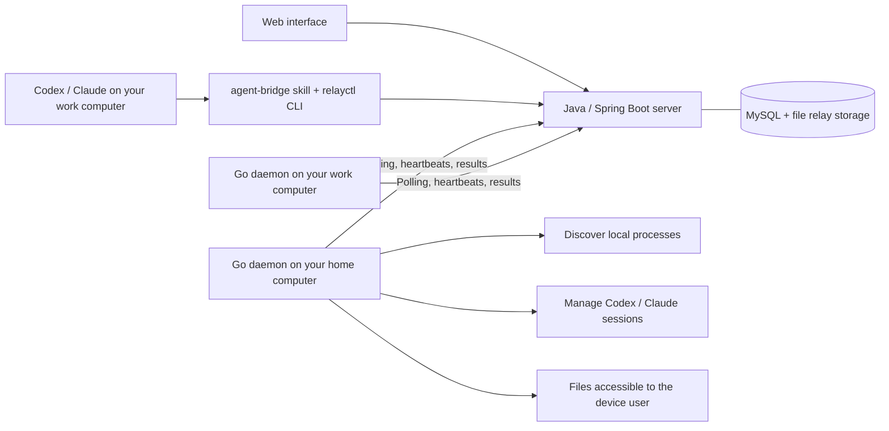

# Relay · Cross-device Agent Workspace

[简体中文](README.md) | English

Relay brings Codex and Claude Code sessions from all your computers into one workspace. Follow live replies, continue conversations remotely, retrieve files, and let agents on different devices send instructions to each other and collaborate on tasks.

Relay is an early, self-hostable version. Hosting your own server gives you control over accounts, conversations, and storage. The `relay.chaojibot.com` address in the examples is an existing hosted instance; replace it with your own domain when self-hosting. See the [self-hosting guide (Chinese)](deploy/README.md) and [contribution guide (Chinese)](CONTRIBUTING.md).

## Use the hosted service

You can use the **[Relay hosted service](https://relay.chaojibot.com)** directly, without deploying a server:

1. Open the website, register and sign in, then create a key in the Account & SK panel (`账号与 SK`).
2. Follow [Install on a device](#install-on-a-device) below to install the CLI, skill, and daemon on each device. Enter your own SK during setup.
3. Return to the web interface to browse sessions across your devices, send instructions, and retrieve files. You can also use `relayctl` or the skill.

The installation commands below connect to the hosted service by default. Codex / Claude Code still run on your devices, so install and authenticate the corresponding CLIs first. When self-hosting, replace the server address with your own domain.

## Install on a device

The hosted [installation and usage guide (Chinese)](https://relay.chaojibot.com/docs/) covers CLI downloads, credentials, skill installation, automatic startup, diagnostics, updates, and removal. Its source is [docs/install.md](docs/install.md). Devices do not need to build the source.

Ask an agent on the target device to install Relay with a single instruction:

> Read https://relay.chaojibot.com/install-agent.md and help me install and connect the Relay CLI and agent-bridge skill. Enable automatic startup and synchronize all my sessions on this machine. Reuse existing local credentials if available; otherwise, prompt me to enter my token in the terminal with input hidden.

Or run this on the target device; no project directory is required:

```bash
curl -fsSL https://relay.chaojibot.com/install.sh | bash -s -- --setup
```

The installer verifies SHA-256 checksums, installs `~/.local/bin/relayctl`, and installs the skill for both Codex and Claude Code by default. Connected devices can resume sessions and read files across directories according to the current operating system user's permissions, without a directory allowlist. Omit `--setup` to install only the CLI and skill; use `--token-file /private/path` for unattended setup. Install and authenticate the model CLIs beforehand. Installing Relay does not send model requests.

## Try the full workflow locally

Local development requires Go 1.18+, JDK 17+, Maven 3.6.3+, and MySQL 8.0+. The demo also requires Python 3.9+. Create a dedicated database and database account, then configure:

```bash
export RELAY_DB_URL='jdbc:mysql://127.0.0.1:13306/relay?useUnicode=true&characterEncoding=UTF-8&serverTimezone=UTC'
export RELAY_DB_USERNAME=relay
export RELAY_DB_PASSWORD='YOUR_DATABASE_PASSWORD'
```

Development scripts can also read the ignored `.local/relay.env` file. Use the three variables above in `KEY=value` format and set its permissions to `0600`. Create the database before starting the server; Flyway creates its tables on first startup. Use a database separate from other applications.

The demo needs SMTP configured for registration emails. See [.env.example](.env.example) and the [installation guide (Chinese)](docs/install.md) for settings. A local SMTP receiver can be used during development; registration still requires email verification. Development scripts read `.local/relay.env` and the process environment. Only Docker Compose automatically loads the root `.env` file.

```bash
make build
python3 scripts/demo.py
```

If your default Java is still version 8 or 11, select JDK 17+ for the build command, for example `JAVA_HOME=/opt/homebrew/opt/openjdk make build`. You do not need to change your global Java configuration.

Open the URL printed in the terminal, register or sign in to your Relay account, create an SK (an account API key), and follow the terminal prompts to configure it. The demo starts the server and three device daemons: `home` and `work` use separate directories under `.demo/` to simulate two devices; `local` connects the current machine and discovers the current user's Codex and Claude sessions across projects. Demo state is stored in `.demo/`. No model requests are sent automatically.

In the sidebar's Files panel, select `home` and request `XX.txt` to retrieve and download the sample file. Sending a message in a conversation invokes the corresponding device's authenticated Codex or Claude Code CLI. Agent permissions follow the rules below; the demo directories do not provide operating system isolation.

Press Ctrl-C to stop the demo. Restarting reuses device identities and history. The demo selects an available port starting at 8765; use the URL it prints, or set `AM_DEMO_PORT=8766` to choose a fixed port.

## Connect two computers

Build the CLI on your development machine, then place the binary for each platform on that device's PATH:

```bash
go build -o bin/relayctl ./cmd/relayctl
# Install locally into $(go env GOPATH)/bin; ensure it is on PATH.
go install ./cmd/relayctl

# Example: cross-compile for Linux amd64.
CGO_ENABLED=0 GOOS=linux GOARCH=amd64 go build -o bin/relayctl-linux-amd64 ./cmd/relayctl
```

Each device needs only `relayctl` and an authenticated Codex or Claude CLI. Go is required only on the build machine.

Building the server requires JDK 17+ and Maven:

```bash
mvn -f server/pom.xml package
java -jar server/target/relay-server.jar --server.address=0.0.0.0 --relay.data=./data

# The CLI can also start the same Java server.
bin/relayctl serve --host 0.0.0.0 --port 8765 --data ./data
```

Deployment requires only JRE 17+ and the built `relay-server.jar`, which includes the web interface. Place the jar next to `relayctl` or set `RELAY_SERVER_JAR` to its location. `relayctl serve` looks for a suitable Java 17+ installation and invokes Maven if the jar is missing from a source checkout. When using `java -jar` directly, check that command's Java version.

Register or sign in through the web interface, then create a key in the Account & SK panel (`账号与 SK`) for CLI access. The web interface and API share one port.

On your home computer:

```bash
relayctl configure --server https://relay.example.com
# Enter your account SK when prompted; input is hidden.

relayctl daemon run --name home
```

On your work computer:

```bash
relayctl configure --server https://relay.example.com
relayctl daemon run --name work

# Retrieve a file from home to your current computer.
relayctl files pull --device home --path XX.pdf --output ./XX.pdf
```

Replace the example domain with your server's address. For LAN testing, you can use `http://SERVER_IP:8765`. Use an HTTPS reverse proxy for public connections, or connect over an existing private network. Devices need outbound access to the server; they do not need public IP addresses or inbound ports. Browser download verification requires HTTPS or localhost. CLI downloads also verify files over HTTP.

### Start automatically at login

Stop any foreground daemon with Ctrl-C before installing its user service:

```bash
relayctl daemon install --name home
relayctl daemon uninstall --name home
```

macOS uses a LaunchAgent. Linux uses `systemd --user` and requires a working user session; an administrator can enable linger if the daemon should keep running after logout. The service runs the Go binary at its installed path and preserves the installation-time PATH, `CODEX_HOME`, and `CLAUDE_CONFIG_DIR`. Keep the executable at that path. The service does not depend on the project directory or a virtual environment. macOS logs are in `~/.config/agent-manager/logs/`; on Linux, use `journalctl --user -u 'dev.relay.agent-*'`.

A device is identified by its machine, operating system user, and server. Renaming it or changing working directories does not create duplicate devices. Foreground and service runs share the same identity, and a machine-wide file lock prevents duplicate daemons. Installation changes only the current user's configuration and does not require root.

### Discover sessions across the machine

One daemon per machine is enough. By default, it scans the current user's `~/.codex/sessions` and `~/.claude/projects`, including other project directories and histories with more than 50 sessions. Use `CODEX_HOME` or `CLAUDE_CONFIG_DIR` for custom locations. Claude subagent records are not listed as separate sessions.

Once connected, you can resume sessions in any available working directory and read files accessible to that operating system user. Relative file paths resolve against the user's home directory. Absolute paths and symbolic links follow operating system permissions. No `--root` or per-directory authorization is required; the current CLI ignores legacy `--root` service arguments for compatibility. Session history remains readable when its working directory is unavailable or its model CLI is missing.

```bash
relayctl daemon run
# Or install automatic startup at login.
relayctl daemon install
```

To consolidate devices registered by directory in earlier versions, stop the old daemons, start the current version with one old `--state-dir`, and merge the remaining identities. Complete or cancel all tasks on the old devices first. Identities from different machines are rejected. Matching native sessions are combined while preserving tasks, messages, and files; old session IDs resolve to the combined session, and old device tokens are invalidated. Restart the target daemon after merging so native messages can be synchronized and deduplicated.

```bash
relayctl devices merge --into TARGET_ID --from OLD_ID --dry-run
relayctl devices merge --into TARGET_ID --from OLD_ID
```

`--virtual-device --name NAME` is only for simulating multiple devices on one machine. It scopes session discovery to the simulation directory, while file access still follows the current user's permissions. Normal devices do not need it.

## Send instructions to a remote agent

Install and authenticate the corresponding model CLI on the device first. Relay uses that device user's existing CLI login; it does not upload model account credentials to the management server.

```bash
relayctl devices
relayctl agents create --device home --kind codex --name home-codex --cwd /Users/you/projects/app
relayctl agents create --device home --kind claude --name home-claude --cwd /Users/you/projects/app
relayctl agents list

relayctl send home-codex 'Read the README and explain how to start the project' --wait
relayctl send home-codex 'Based on that, check the dependency configuration too' --wait

# Asynchronous task: returns a job ID.
relayctl send home-claude 'Inspect the structure of this project'
relayctl jobs list
relayctl jobs show JOB_ID
relayctl jobs wait JOB_ID --timeout 600
relayctl jobs cancel JOB_ID
```

Query and task commands return JSON. Errors exit with code 1. `--server` and `--token` are global options and must precede the subcommand. `AM_SERVER` and `AM_TOKEN` override saved connection settings. Prefer a private configuration file with permissions `0600` to avoid putting tokens in shell history.

The device selector at the top of the sidebar switches between all devices and one device, showing session counts and online status. Your selection persists across reloads. The all-device list mixes sessions by most recent activity and groups them into today, yesterday, the last 7 days, the last 30 days, and older. Compact device labels, Codex / Claude badges, and truncated project names identify each row; hover for full names and session IDs. Selecting one device filters its sessions. The device dialog also links to its sessions, and new conversations and file requests default to the selected device.

All conversations use the same composer. Enter sends, Shift+Enter inserts a newline, and each session keeps its own draft. Follow-up messages queue while a reply is running. You can stop Relay-initiated execution and receive a new-message indicator while reading older history. Switching devices restores the last viewed session and preserves drafts.

**Existing local sessions can be continued remotely.** The daemon reads native records under `$CODEX_HOME/sessions/` and `$CLAUDE_CONFIG_DIR/projects/` (defaulting to `~/.codex` and `~/.claude`) across the current user's working directories. New user and assistant messages from the terminal appear in the web interface. Messages sent from the web resume the original session ID and retain its context. Native records and Relay tasks share a paginated timeline, independent of the global list's most recent 100 jobs.

If a native session is already processing a turn, web messages queue until its records indicate completion. Relay does not inject keystrokes into arbitrary processes or run a second controller against the original terminal. A terminal that crashes without recording completion may leave its session marked busy; finish or recover that turn in the original tool. The cancel button stops only execution initiated by Relay.

Session discovery scans approximately every 5 seconds. It discovers files in batches, incrementally reads complete JSON records, and deduplicates messages using stable IDs after reconnecting. Partial records are read on the next pass. Each CLI has a limit of 100 newly parsed files per pass; subsequent passes continue discovery. The initial read of a large file covers its last 2 MiB, with older native history remaining on the device. Claude subagent conversations and internal model reasoning are excluded from the timeline. Individual messages retain up to 64,000 characters.

Process discovery reads only the current user's PIDs and executable names; command-line arguments are not uploaded. A process without recoverable session records is not presented as a conversation that can receive messages.

Since Relay 0.4, if an existing Codex session is loaded in the local shared service, Relay continues it through that service and collects streaming replies, avoiding `already has an active writer`. An active local turn finishes first. Cancellation affects only Relay-initiated turns and does not close the Codex service. Each submitted turn uses its selected permission mode (the daemon's read/write settings by default); immediately after submission, Relay restores the original permissions for subsequent local turns. The shared service must support independently updating settings for future turns. This has been verified with isolated Codex 0.166 / 0.167 instances.

When the shared service is unavailable or has not loaded the session, ask mode uses a temporary app-server and other modes use the CLI. If a separate process holds the session, exit it locally before continuing through Relay. A disconnect after submission does not automatically retry through another channel; verify the original turn's state first. Restart the Relay daemon after upgrading its CLI.

New conversations normally begin with `codex exec --json` or `claude -p --output-format stream-json`. Codex ask mode uses app-server, and Claude ask mode uses bidirectional streaming input. All modes retain native transcripts and session IDs for later continuation. Existing native sessions use their original IDs. Idle managed conversations have no persistent model subprocess; one starts when a task arrives. Tasks run serially within a conversation, with up to 4 concurrent tasks per device.

Task output synchronizes approximately every 2 seconds, and the web interface checks for new messages every second. Claude provides incremental text; Codex updates follow its CLI message events. Up to 64,000 output characters are retained. Starting with CLI 0.6.1, web messages and `relayctl send` have no default execution deadline: they run until completion or manual cancellation. Set `--timeout 600` for an explicit 600-second limit (1–1800 seconds); `0` means unlimited. `send --wait` waits without a default deadline, while `jobs wait --timeout` only limits the local wait and does not stop the remote job. Upgrade and restart older daemons before they can accept unlimited tasks. Internal stderr diagnostics are stored separately from assistant replies and can be expanded under execution logs; actual execution failures remain visible. Tasks for offline devices remain queued. If a running device loses contact for over 60 seconds, its task fails and **is not automatically retried**. After roughly 30 seconds of disconnection, the daemon attempts to stop its running subprocesses. Verify a task's outcome before resubmitting it: external actions cannot be guaranteed to execute exactly once.

### Agent execution permissions

By default, Codex uses the `read-only` sandbox with `approval_policy=never`. Claude uses `dontAsk`, provides only `Read,Glob,Grep`, and disables MCP. The default mode does not bypass all permission checks.

To allow remote project changes, explicitly enable writes on the device:

```bash
relayctl daemon run --name home --allow-agent-writes
```

Codex then uses `workspace-write`. Claude receives its full built-in tool set, retains local settings, skills, and MCP configuration, and automatically allows `Read,Glob,Grep,Edit,Write,Bash`. Existing local deny rules still apply. Other tools requiring approval follow the local allow rules; the daemon does not display interactive terminal approval prompts. Claude's Bash runs with the device user's permissions. File access and agent working directories follow operating system permissions, without a Relay directory allowlist. Model behavior, CLI configuration, hooks, and shells remain subject to the device user's and tool's settings. Use a container or separate operating system user when stronger isolation is needed.

For automatic startup, use `relayctl daemon install --allow-agent-writes`. To replace an existing read-only service, run `relayctl daemon uninstall` and reinstall with that option; configuration, device identity, and sessions are preserved. `daemon restart` alone retains the service's existing read-only settings. If a web-launched Claude session reports that it can only read files and cannot run code, check this option on the target device.

Starting with CLI **0.6.0**, the web composer provides a permission selector for both Codex and Claude Code. Each conversation remembers its choice. It applies to the **next submitted message**; queued and running messages keep their original permission snapshot.

| Web option | Codex | Claude Code |
| --- | --- | --- |
| Device default | Device read-only or `workspace-write`, without approval requests | Device read-only or the tool allowlist described above |
| Ask for approval | `workspace-write` + `on-request`; project operations may run directly, while extra permissions require web approval | Normal permission rules; tools requiring confirmation appear in the web interface, preserving local settings, skills, and MCP |
| Full access | `danger-full-access` + `never` | `bypassPermissions`; local and organization policies may still restrict operations |

Ask and full access require the target device to run CLI 0.6.0 with `--allow-agent-writes`. The web interface cannot override a read-only device. Run `relayctl daemon restart` after upgrading. Full access allows file access, commands, and networking as the device user; select it only for trusted tasks.

Approval cards show the command, file changes, or tool arguments and offer a single-operation allow or deny. They never save persistent allow rules; Codex permission sets are granted only for the current turn. Streaming continues while waiting, and pending requests survive page refreshes. Cancellation, timeouts, device lease loss, and requests withdrawn by the native tool invalidate pending approvals. When an explicit job timeout is set, approval waiting counts toward it; otherwise there is no fixed deadline. Claude's existing allow rules may allow tools directly, and its deny rules cannot be overridden by browser approval. Interactions requiring typed answers, such as `AskUserQuestion`, are not yet supported. The bridge handles Relay-initiated turns; approvals belonging to native clients remain with those clients.

## Install the agent-to-agent skill

```bash
relayctl skill install --target both
# Or use --target codex / --target claude.
```

The skill source is [`relayctl/skills/agent-bridge/SKILL.md`](relayctl/skills/agent-bridge/SKILL.md). The CLI copies it into `$CODEX_HOME/skills/agent-bridge` (default `~/.codex/skills/`) and `$CLAUDE_CONFIG_DIR/skills/agent-bridge` (default `~/.claude/skills/`). If the installed content differs, use `--force` to back it up and replace it. Reopen your agent session, then ask:

> Use agent-bridge to retrieve Documents/XX.pdf from my home computer into the current directory.

> Ask home-codex to inspect the README of the project on my home computer and explain how to start it.

Each device initiating a request needs `relayctl` and a configured server connection. The skill calls the CLI, which contacts the server, which delivers the task to the target device. A managed agent that calls the CLI also needs permission to execute commands and its own configured connection. The default read-only Claude configuration does not include Bash.

## Transfer files

```bash
relayctl files pull --device home --path /Users/you/Documents/XX.pdf --output ./XX.pdf
relayctl files list
relayctl files download FILE_ID --output ./another-copy.pdf
```

Binary files, Unicode paths, and empty files are supported. The maximum file size is **16 MiB**. Relative paths resolve against the remote operating system user's home directory. Absolute paths and symbolic links follow that user's permissions. Downloads verify SHA-256 and create the destination exclusively, without overwriting existing files or symbolic links. Read errors, missing paths, and insufficient permissions return failures.

Files are stored and relayed through the server without invoking a model or consuming model tokens. HTTPS provides transport encryption; **Relay does not provide end-to-end encryption**. Files and images are isolated by account. Ordinary transferred files are stored in the server's `data/files` directory, while conversation images upload directly to private OSS storage. Server and storage administrators can still access their contents. Ordinary files currently have no automatic retention policy. Unsent image drafts are retained for 24 hours; sent images remain in conversation history.

## Deploy the server

Use a dedicated MySQL database, SMTP, and an HTTPS reverse proxy. See the [self-hosting and maintenance guide (Chinese)](deploy/README.md) for the full procedure.

```bash
cp .env.example .env
chmod 600 .env
# Edit .env with database, SMTP, and domain settings; images also require OSS.
make downloads
docker compose up -d --build
```

Docker builds with Maven; the final image contains the Java runtime and server jar. Compose binds the server to the host's `127.0.0.1:8765`, stores data in a Docker volume, and runs as a non-root user. Expose it through your HTTPS reverse proxy. The server has no preset administrator token: verify your email to register through the web interface, then create a personal SK. `GET /healthz` is an unauthenticated health check that verifies MySQL connectivity and returns `503` on failure.

Relay has its own email-based account system, including verification-code registration, password resets, and browser sessions using HttpOnly cookies valid for 7 days. Each account's devices, conversations, tasks, files, and images are isolated. All SKs have read/write access, support expiration and revocation, and reveal their full value only once. On first registration, each device receives a token scoped to polling and reporting its own tasks. Resetting a password revokes existing login sessions and SKs while preserving device identities. Organization sharing, task audit exports, and high availability are not implemented.

## Architecture and API



| Endpoint | Purpose | Authentication |
| --- | --- | --- |
| `GET /api/state` | Devices, sessions, the most recent 100 jobs, and files | Login cookie / account SK |
| `POST /api/register` | Register a device and return its device token | Login cookie / account SK |
| `POST /api/agents` | Create a managed session | Login cookie / account SK |
| `GET /api/agents/:id/messages` | Conversation history, current replies, and follow-up messages | Login cookie / account SK |
| `POST /api/jobs` | Send instructions or request a file | Login cookie / account SK |
| `GET /api/jobs/:id` | Retrieve a job | Login cookie / account SK |
| `POST /api/jobs/:id/cancel` | Cancel a job | Login cookie / account SK |
| `POST /api/jobs/:id/approvals/:approval` | Allow / deny an operation | Login cookie / account SK |
| `POST /api/device/jobs/:id/approvals` | Create an approval request | Corresponding device token |
| `GET /api/device/jobs/:id/approvals/:approval` | Read the decision | Corresponding device token |
| `POST /api/device/jobs/:id/approvals/:approval/expire` | Withdraw a pending request | Corresponding device token |
| `GET /api/files/:id` | Download a file | Login cookie / account SK |
| `POST /api/device/poll` | Heartbeats, progress, task pickup, and cancellation delivery | Corresponding device token |
| `POST /api/device/jobs/:id/complete` | Report results and files | Corresponding device token |

Key source locations:

- `server/src/main/java/dev/relay/`: server and task queue.
- `internal/relay/daemon.go`: device daemon.
- `internal/relay/sessions.go`: native session synchronization.
- `internal/relay/task.go`: CLI execution and streaming output.
- `internal/relay/cli.go`: command-line interface.
- `internal/relay/service.go`: user background services.
- `relayctl/static/`: web interface.

Device identities default to `~/.config/agent-manager/devices/`. If an identity directory is lost, use a new device name to avoid confusing it with an existing device. Set `AM_CONFIG_DIR` to isolate configurations.

## Verification

Integration tests require a local MySQL administrator account and the `mysql` client to create and clean up random `relay_test_*` databases. Configure the ignored `.local/mysql-test.json` file with permissions `0600`:

```json
{"host":"127.0.0.1","port":13306,"user":"root","password":"YOUR_LOCAL_TEST_PASSWORD"}
```

Alternatively, set `env_file` to an existing local environment file containing `MYSQL_ROOT_PASSWORD`. The test harness restricts connections to the local machine and cleans up only databases it creates. Browser tests use the same configuration. Use dedicated local test credentials, separate from production.

The test SMTP receiver requires Python 3.9–3.11; its `smtpd` dependency was removed from the standard library in Python 3.12. See [CONTRIBUTING.md (Chinese)](CONTRIBUTING.md) for the complete development setup.

```bash
make build
go test -race ./...
python3 -m unittest discover -s tests -v
node --check relayctl/static/app.js
```

Optional browser end-to-end tests require Playwright and Chromium. On macOS, the scripts prefer an installed Chrome:

```bash
python -m pip install -r tests/requirements.txt
python -m playwright install chromium webkit
python tests/browser_smoke.py
python tests/permissions_smoke.py
```

To run the login-loading and account/image regressions used in CI, install WebKit as well:

```bash
python -m playwright install chromium webkit
python tests/auth_loading_smoke.py
python tests/account_images_smoke.py
```

Java unit tests cover parameter validation and health checks when the database is unavailable. Go tests cover incremental records, incomplete JSON, streaming-message deduplication, access across directories, and concurrent reads. Integration tests start a real Java server and separate Go device daemons against temporary MySQL databases. Executables simulating Codex / Claude JSON protocols exercise conversation continuation, serial scheduling, cancellation, model errors, expired leases, authorization isolation, binary transfer, file-size limits, and directory access. They do not call paid models. Verify real CLI authentication and version compatibility on the target device; execution arguments have also been checked against the installed CLIs' `--help` output.

Optional compatibility tests against the real Codex CLI use a temporary `CODEX_HOME` and a local mock model endpoint. They verify writer conflicts, continuation of existing sessions, approval allow/deny, full access, read-only permissions, and restoration of local permissions without using personal sessions or paid models:

```bash
RELAY_CODEX_TEST=1 go test -race ./internal/relay -run 'TestSharedCodexAgainstRealCLI|TestCodexPermissionsAgainstRealCLI' -count=1
RELAY_CLAUDE_TEST=1 go test -race ./internal/relay -run TestClaudePermissionsAgainstRealCLI -count=1
# Set RELAY_CODEX_TEST_BINARY=/path/to/codex to select a shared-service version.
```

Permission protocols: [Codex app-server](https://developers.openai.com/codex/app-server/) and [Claude Agent SDK permissions](https://platform.claude.com/docs/en/agent-sdk/permissions).

Integration references: [Codex non-interactive](https://developers.openai.com/codex/noninteractive/) and [Claude Code programmatic usage](https://code.claude.com/docs/en/headless).

### Images and mobile use

Web conversations support selecting, pasting, and dropping images, previewing or removing attachments, and retaining them with messages. Codex and Claude Code receive native image inputs. Before upload, the browser limits the longest edge to 2048 pixels and compresses each image to at most 1 MiB, retaining smaller PNGs. Images upload directly to a private OSS bucket through V4 presigned PUT URLs. The server verifies the upload before recording it.

After account authorization, previews and full-size views use GET signatures valid for 5 minutes to read directly from OSS. Image bytes do not pass through Relay. Reloading or reopening obtains fresh signatures. Messages support up to 4 images; server and device validation limits remain 5 MiB per image and 12 MiB total. The target device needs CLI 0.5 or newer. See [OSS image upload and preview (Chinese)](docs/images.md).

The mobile layout uses input text of at least 16px and the visual viewport height to accommodate Safari's software keyboard while preserving browser zoom. See the [installation guide (Chinese)](docs/install.md) for registration, SMTP, and setup details.

Since CLI 0.5.3, original images are stored persistently in the target device's configuration directory. They remain accessible across turns and daemon restarts and are no longer deleted when a single reply finishes. Device originals currently have no automatic cleanup. Upgrade older device CLIs and restart their daemons to use this behavior.

## License

Relay is released under the [MIT License](LICENSE). Third-party dependencies and bundled browser libraries retain their own licenses; see [third-party notices](THIRD_PARTY_NOTICES.md).
