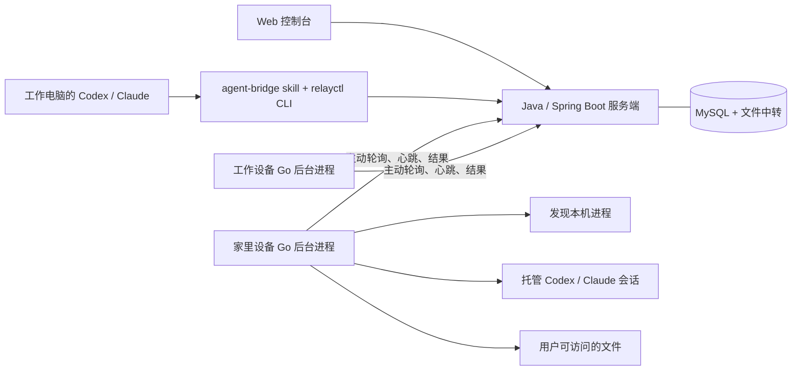

# Relay · 跨设备 Agent 工作台

简体中文 | [English](README.en.md)

Relay 让你在一个工作台管理各台电脑上的 Codex 和 Claude Code 会话，查看实时回复、远程续聊和取回文件。不同设备上的 Agent 也能相互发送指令，协作完成任务。

点击回复中的 Markdown 文件链接，即可从来源设备取回，在侧栏预览 Markdown、代码、文本或图片，并下载原文件；手机上使用全屏预览。

这是可自建的早期版本。使用自己的服务端可控制账号、会话及存储；文档中的 `relay.chaojibot.com` 是现有托管实例，自建时换成自己的域名。部署步骤见 [自建指南](deploy/README.md)，贡献方式见 [CONTRIBUTING.md](CONTRIBUTING.md)。

## 直接使用托管版

无需自行部署服务端，可以直接使用 **[Relay 托管版](https://relay.chaojibot.com)**：

1. 打开网页，注册并登录账号，在「账号与 SK」创建密钥。
2. 按照下方的[安装到设备](#安装到设备)步骤，在每台设备上安装 CLI、skill 和后台进程，配置时输入自己的 SK。
3. 回到网页，即可查看各设备的会话、发送指令和取回文件，也可以通过 `relayctl` 或 skill 操作。

下方安装命令默认连接托管版。Codex / Claude Code 仍在你的设备上运行，需提前安装并登录对应 CLI；自建用户将服务端地址换成自己的域名即可。

## 安装到设备

完整的 [安装与使用文档](https://relay.chaojibot.com/docs/) 已放到服务端，包括 CLI 下载、令牌配置、skill 安装、后台自启、检查、更新和卸载；源码文档为 [docs/install.md](docs/install.md)。设备无需构建源码。

让目标设备上的 Agent 安装，发送一句话：

> 请阅读 https://relay.chaojibot.com/install-agent.md，帮我安装并连接 Relay CLI 和 agent-bridge skill，设置后台自启并同步整机会话，令牌优先复用本机已有配置，没有则提示我在终端隐藏输入。

或者在目标设备执行，整机注册无需指定目录：

```bash
curl -fsSL https://relay.chaojibot.com/install.sh | bash -s -- --setup
```

脚本校验 SHA-256 后安装 `~/.local/bin/relayctl`，默认给 Codex 与 Claude Code 安装 skill。接入后按当前系统用户权限访问各目录，可直接续聊和取文件，无需配置目录白名单。仅下载 CLI 和 skill 时去掉 `--setup`；无人值守使用 `--token-file /private/path`。模型 CLI 需提前安装并登录；安装不触发模型请求。

## 先体验完整链路

本地开发需要 Go 1.18+、JDK 17+、Maven 3.6.3+ 和 MySQL 8.0+；演示脚本额外需要 Python 3.9+。使用独立数据库和账号，启动前配置：

```bash
export RELAY_DB_URL='jdbc:mysql://127.0.0.1:13306/relay?useUnicode=true&characterEncoding=UTF-8&serverTimezone=UTC'
export RELAY_DB_USERNAME=relay
export RELAY_DB_PASSWORD='你的数据库密码'
```

开发脚本也可读取被忽略的 `.local/relay.env`，格式为上述三个变量的 `KEY=value`，文件权限设为 `0600`。Flyway 在首次启动时自动建表；数据库需预先创建。不要使用其他应用已有的数据库。

演示需要配置注册邮件；SMTP 环境变量示例见 [.env.example](.env.example) 和 [安装文档](docs/install.md)。本地开发可使用本机 SMTP 接收器；首次注册不会绕过邮箱验证。开发脚本读取 `.local/relay.env` 及当前进程环境，Compose 才会自动读取根目录 `.env`。

```bash
make build
python3 scripts/demo.py
```

若默认 Java 仍是 8 / 11，请为构建命令指定 JDK 17+，例如 `JAVA_HOME=/opt/homebrew/opt/openjdk make build`；无需修改全局 Java 配置。

打开终端显示的地址，注册或登录自己的 Relay 账号，创建 SK 并按终端提示配置。脚本启动服务端与三个设备后台进程：`home`、`work` 使用 `.demo/` 内的独立目录模拟两台设备；`local` 连接当前机器，自动同步当前用户各目录下的 Codex / Claude 会话。演示状态保存在 `.demo/`，不会自动发起模型请求。

在侧栏「文件」选择 `home`，输入 `XX.txt`，即可取回示例文件并下载。在会话输入框发送指令，会调用对应设备已登录的 Codex / Claude Code。模型权限受下文说明约束，演示目录不是操作系统隔离环境。

退出使用 Ctrl-C；再次启动会复用设备身份及历史。默认从 8765 起选择空闲端口，以终端实际输出地址为准；也可设置 `AM_DEMO_PORT=8766` 固定端口。

## 实际连接两台电脑

在开发机器构建 CLI，再将对应平台的二进制放到每台设备的 PATH 中：

```bash
go build -o bin/relayctl ./cmd/relayctl
# 本机安装到 $(go env GOPATH)/bin，确保该目录在 PATH 中
go install ./cmd/relayctl

# 示例：为 Linux amd64 设备交叉编译
CGO_ENABLED=0 GOOS=linux GOARCH=amd64 go build -o bin/relayctl-linux-amd64 ./cmd/relayctl
```

每台设备仅需 `relayctl` 和已登录的 Codex / Claude CLI。Go 编译器只在构建机器上需要。

服务端需要 JDK 17+；构建还需要 Maven：

```bash
mvn -f server/pom.xml package
java -jar server/target/relay-server.jar --server.address=0.0.0.0 --relay.data=./data

# 也可使用 CLI 启动同一个 Java 服务端
bin/relayctl serve --host 0.0.0.0 --port 8765 --data ./data
```

部署时只需 JRE 17+ 和构建好的 `relay-server.jar`，管理页面已打包在 jar 内。可把 jar 放在 `relayctl` 旁边，或通过 `RELAY_SERVER_JAR` 指定位置。`relayctl serve` 会寻找可用的 Java 17+；源码目录缺少 jar 时会调用 Maven 构建。命令行直接使用 `java -jar` 时，请确认该 `java` 的版本。

用户先在网页注册/登录，在「账号与 SK」创建密钥供 CLI 使用。管理页面与 API 使用同一个端口。

在家里的电脑配置连接并运行后台进程：

```bash
relayctl configure --server https://relay.example.com
# 隐藏输入本账号 SK

relayctl daemon run --name home
```

在工作电脑上：

```bash
relayctl configure --server https://relay.example.com
relayctl daemon run --name work

# 从家里取文件到当前电脑
relayctl files pull --device home --path XX.pdf --output ./XX.pdf
```

将示例域名换成实际服务端地址。局域网测试可用 `http://服务端IP:8765`；经公网连接时通过反向代理提供 HTTPS，或在已有私有网络内使用。设备只需能访问服务端，不需要公网 IP 或入站端口。浏览器文件下载校验需要 HTTPS 或 localhost；CLI 在 HTTP 下也会校验文件。

### 登录后自动运行

在每台设备上，将前台进程用 Ctrl-C 停止后安装用户服务：

```bash
relayctl daemon install --name home
relayctl daemon uninstall --name home
```

macOS 使用 LaunchAgent；Linux 使用 `systemd --user`，需可用的用户会话。Linux 如需退出登录后继续运行，可由系统管理员为该用户启用 linger。服务直接运行安装时的 Go 二进制，保留当时的 PATH、`CODEX_HOME`、`CLAUDE_CONFIG_DIR`。安装后请保持该可执行文件路径有效；不依赖项目目录或虚拟环境。macOS 日志在 `~/.config/agent-manager/logs/`；Linux 使用 `journalctl --user -u 'dev.relay.agent-*'`。

设备按「机器 + 系统用户 + 服务端」识别，改名或换工作目录都不会重复注册。服务与前台运行复用同一设备身份，并有整机文件锁防止重复启动。后台服务安装只写入当前用户配置，不需要 root。

### 整机发现与文件访问

每台机器运行一个后台进程即可。默认扫描当前系统用户的 `~/.codex/sessions` 和 `~/.claude/projects`，包括其他项目目录及超过 50 个的历史会话；自定义位置使用 `CODEX_HOME` / `CLAUDE_CONFIG_DIR`。Claude 子代理记录不作为独立会话列出。

连接后可远程续聊任意可用工作目录的会话、读取当前系统用户可访问的文件。相对文件路径基于该用户主目录，绝对路径和符号链接也按系统权限处理。无需 `--root` 或逐目录授权；旧服务参数里的 `--root` 会被新版 CLI 兼容忽略。工作目录不存在或缺少 CLI 时仍可查看会话历史。

```bash
relayctl daemon run
# 或登录后自启
relayctl daemon install
```

旧版本按目录注册的设备可先停止旧进程，使用其中一个旧 `--state-dir` 启动新版，再合并其余旧身份。合并前必须完成或取消旧设备任务；不同机器的身份会被拒绝。相同原生会话会合并显示，历史任务、消息和文件保留，旧会话 ID 自动指向合并后的会话，旧设备令牌失效。合并后重启目标后台进程，让原生消息完成一次去重同步。

```bash
relayctl devices merge --into TARGET_ID --from OLD_ID --dry-run
relayctl devices merge --into TARGET_ID --from OLD_ID
```

`--virtual-device --name NAME` 只用于在同一机器上演示多个模拟设备，仅按模拟目录区分会话发现，文件访问仍遵循当前用户权限；正常设备无需使用。

## 给远程 Agent 发指令

设备上需事先安装相应 CLI，并完成其登录。Relay 使用设备用户已有的 CLI 登录态，不把模型账号凭证传给管理服务端。

```bash
relayctl devices
relayctl agents create --device home --kind codex --name home-codex --cwd /Users/you/projects/app
relayctl agents create --device home --kind claude --name home-claude --cwd /Users/you/projects/app
relayctl agents list

relayctl send home-codex '阅读 README，告诉我如何启动项目' --wait
relayctl send home-codex '结合刚才的结果，再检查一下依赖配置' --wait

# 异步任务：返回任务 ID
relayctl send home-claude '检查这个项目的结构'
relayctl jobs list
relayctl jobs show JOB_ID
relayctl jobs wait JOB_ID --timeout 600
relayctl jobs cancel JOB_ID
```

所有查询和任务命令返回 JSON；错误退出码为 1。`--server` / `--token` 是全局选项，放在子命令前。环境变量 `AM_SERVER`、`AM_TOKEN` 可覆盖连接配置；推荐保存到权限为 `0600` 的私有配置文件，避免把令牌写进命令历史。

侧栏顶部「切换设备」可选择全部设备或某一台，显示每台的会话数及在线状态，刷新后保留选择。全部设备的会话按最新活跃时间混排，分为今天、昨天、近 7 天、近 30 天和更早；每行用短设备标记、Codex / Claude 徽标和省略显示的项目名称区分，完整名称及会话 ID 可悬停查看。选择单台后仅显示该设备的会话；设备弹窗中的「查看会话」也可直接跳转，新建会话和取文件默认使用当前设备。所有会话使用同一个输入框；支持 Enter 发送、Shift + Enter 换行、逐会话草稿、回复中的后续消息排队、停止 Relay 发起的执行，以及翻阅历史时的新消息提示。切换设备会恢复上次查看的会话，草稿保留。

**已有本机会话也可以继续。** 设备端自动读取 `$CODEX_HOME/sessions/` 和 `$CLAUDE_CONFIG_DIR/projects/`（默认 `~/.codex`、`~/.claude`）内的会话记录，默认同步当前用户所有工作目录的会话，工作目录可用时可直接续聊。终端中新追加的用户和助手消息会持续同步到网页；从网页追加的消息通过原会话 ID 继续执行，保留上下文。已有记录与 Relay 发出的多轮任务合并为一条时间线，支持分页读取，不受全局最近 100 条任务限制。

CLI 0.6.7 起，支持共享服务的 Codex 会话在执行中也能接收网页补充消息，保持当前轮次的权限，确认接收后继续在原会话中回复。旧设备、独立 CLI 执行进程和 Claude 仍按顺序等待上一轮结束。取消按钮只停止 Relay 发起的执行。

会话发现每约 5 秒扫描记录目录，分批发现全部文件，每轮增量读取完整 JSON 记录，重连时按稳定消息 ID 去重；正在写入的半条记录会留到下轮。每种 CLI 每轮最多解析 100 个新文件，后续继续扫描，不再限制为最近 50 个会话。每个大文件首次读取最后 2 MiB，早于这部分的原生历史仍留在设备端。Claude 子会话和模型内部思考不进入对话记录。单条消息最多保留 64,000 字符。

进程发现仍只读取当前用户的 PID 与可执行名称，不上传进程参数。无可恢复会话记录的进程不会伪装为可收发消息的会话。

Relay 0.4 起，已有 Codex 会话若仍加载在本机共享服务中，Relay 通过该服务接续并收集流式回复，避免 `already has an active writer`。本机正在执行的轮次会先完成；取消只作用于 Relay 发起的轮次，不会关闭 Codex 服务。执行使用本条消息选择的权限（默认遵循设备端读写设置），提交后立即恢复本机会话后续轮次的原权限。共享服务需支持独立更新后续轮次设置，已使用 Codex 0.166 / 0.167 的隔离实例验证。共享服务不可用或未加载该会话时，按需审批使用临时 app-server，其他模式使用 CLI；独立进程占用的会话需在本机退出后再从 Relay 继续。提交后断线不会自动换通道重试，需先核实原会话。升级 CLI 后重启 Relay 后台进程生效。

新建会话可直接浏览目标设备的文件夹，或从最近活跃目录中选择，仍支持手动输入路径。最近目录按会话活动更新并保存在服务端，切换浏览器也可使用；浏览功能需要目标设备 CLI 0.6.8 并重启后台进程。

新建 Codex 会话通过原生 app-server 执行；Claude 使用 `claude -p --output-format stream-json`，按需审批和标题生成使用双向流式输入。均保留原生会话记录和 ID，后续可继续对话。CLI 0.6.8 起，Relay 创建的未命名会话会自动生成 AI 标题：Claude 使用原生标题接口，Codex 使用不保留记录的只读临时会话生成后通过原生命名接口保存。生成会增加一次模型请求，不会混入聊天，已有标题保留。空闲托管会话没有常驻模型子进程，收到任务时才启动；同一设备最多并行 4 个模型任务。

任务输出每约 2 秒同步，网页每秒检查新消息。Claude 提供增量文本；Codex 随 CLI 的消息事件更新。保留最近 64,000 字符。CLI 0.6.1 起，网页和 `relayctl send` 默认不设执行时限，直到完成或手动停止；`--timeout 600` 可显式限制为 600 秒，支持 1–1800 秒，`0` 表示不限。`send --wait` 默认持续等待；`jobs wait --timeout` 只限制本次查询等待，不会停止远端任务。旧设备需升级并重启后台进程后才能领取无时限任务。内部 stderr 日志与助手回复分开保存，在网页「执行日志」中按需展开，不影响正常回复；真正的执行错误仍会显示。离线设备的任务保留在队列；执行中的设备失联超过 60 秒则标记失败，**不会自动重跑**。断联超过约 30 秒，后台进程会尝试停止正在执行的子进程。恢复后先核实原任务结果再重发，不能保证外部操作恰好执行一次。

### Agent 执行权限

默认 Codex 使用 `read-only` sandbox 和 `approval_policy=never`；Claude 只提供 `Read,Glob,Grep` 工具并使用 `dontAsk`，不启用 MCP。默认模式不跳过全部权限检查。

需要远程修改项目时，在设备侧明确启用：

```bash
relayctl daemon run --name home --allow-agent-writes
```

此时 Codex 使用 `workspace-write`；Claude 使用完整内置工具，保留本机 settings、skills 和 MCP 配置，自动允许 `Read,Glob,Grep,Edit,Write,Bash`。本机配置中的禁止规则仍然生效；其他需要确认的工具遵循本机已有的允许规则，后台不会弹出终端确认。Claude 的 Bash 具有设备用户的权限。文件访问和 Agent 启动目录使用设备用户的系统权限，不设置 Relay 目录白名单。模型、CLI 配置、hooks 或 shell 的权限由设备用户及各工具配置决定。需强隔离时应在容器或独立系统用户下运行设备进程。

后台自启同样使用 `relayctl daemon install --allow-agent-writes`。已有只读自启服务需要先 `relayctl daemon uninstall`，再用该命令安装，配置、设备身份和会话保留。仅 `daemon restart` 会沿用原来的只读设置。网页中的 Claude 提示“只有只读文件工具，不能运行代码”时，应检查目标设备是否启用了该选项。

CLI **0.6.0** 起，网页输入框旁可为 Codex 和 Claude Code 选择权限，按会话记住选择，从**下一条发送的消息**生效；排队或正在执行的消息保留提交时的权限。

| 网页选项 | Codex | Claude Code |
| --- | --- | --- |
| 设备默认 | 沿用设备只读或 `workspace-write`，不请求审批 | 沿用设备只读或上述工具允许列表 |
| 按需审批 | `workspace-write` + `on-request`；项目内操作可直接执行，额外权限由网页审批 | 使用正常权限规则；需要确认的工具调用通过网页审批，保留本机 settings、skills 和 MCP |
| 完全访问 | `danger-full-access` + `never` | `bypassPermissions`；本机和组织强制规则仍可能限制操作 |

后两项要求目标设备已升级至 0.6.0，并以 `--allow-agent-writes` 启动；网页不能解除设备的只读限制。升级后执行 `relayctl daemon restart`。完全访问允许 Agent 以设备用户权限访问文件、运行命令和联网，仅应在信任该任务时选择。

网页在支持权限选择且已启用可写的设备上默认选择「完全访问」。手动选择后，会在当前浏览器标签页中按会话记住；旧设备或只读设备使用「设备默认」。CLI 的默认权限不变。

审批卡片展示命令、文件变更或工具参数，支持「允许此次操作」和「拒绝」，不会创建永久允许规则；Codex 的权限集合仅授权本轮。等待期间仍接收消息，刷新页面仍能看到未处理请求；取消、超时、失联或原工具撤回请求后审批失效。显式设置任务时限时，等待审批计入该时限；默认无固定时限。Claude 已有的允许规则可直接放行，禁止规则不会被网页审批覆盖；`AskUserQuestion` 等需要填写答案的交互暂不支持。此功能处理从 Relay 发起的轮次，原生客户端自己发起的审批仍由原客户端处理。

## 安装 Agent 间通信 Skill

```bash
relayctl skill install --target both
# 或 --target codex / --target claude
```

skill 源文件在 [`relayctl/skills/agent-bridge/SKILL.md`](relayctl/skills/agent-bridge/SKILL.md)。CLI 会复制到 `$CODEX_HOME/skills/agent-bridge`（默认 `~/.codex/skills/`）及 `$CLAUDE_CONFIG_DIR/skills/agent-bridge`（默认 `~/.claude/skills/`）。内容不同时可加 `--force`，先备份再更新。重新打开 Agent 会话后可说：

> 使用 agent-bridge，把 home 电脑上的 Documents/XX.pdf 取到当前目录。

> 让 home-codex 检查家里那个项目的 README，告诉我如何启动。

每台发起请求的设备都需能运行 `relayctl` 并配置服务端连接。skill 调用 CLI，CLI 连接服务端，服务端将任务交给目标设备。托管 Agent 要自行调用 CLI 时还需具备相应命令执行权限及管理端连接配置；默认只读 Claude 没有 Bash。

## 文件传输

```bash
relayctl files pull --device home --path /Users/you/Documents/XX.pdf --output ./XX.pdf
relayctl files list
relayctl files download FILE_ID --output ./another-copy.pdf
```

支持二进制文件、中文路径、空文件，单文件最大 **16 MiB**。相对路径基于远端系统用户主目录，绝对路径和符号链接遵循该用户的系统权限。下载校验 SHA-256，目标以独占方式创建，不覆盖已有文件或符号链接。文件读取错误、路径不存在或无读取权限都会返回失败。

文件经过服务端持久化中转，不依赖模型，不消耗模型 token。传输加密由 HTTPS 提供，**不提供端到端加密**。文件与图片按账号隔离；普通中转文件保存在服务端 `data/files`，会话图片直传私有 OSS。服务器及存储的管理员仍可访问相应内容。普通文件尚无自动保留期策略；未发送的图片草稿保留 24 小时，已发送图片保留在会话历史中。

## 部署服务端

使用独立 MySQL 数据库、SMTP 和 HTTPS 反向代理，完整步骤见 [自建与维护](deploy/README.md)。

```bash
cp .env.example .env
chmod 600 .env
# 编辑 .env，填写数据库、SMTP、域名；图片另需 OSS
make downloads
docker compose up -d --build
```

Docker 使用 Maven 构建，最终镜像只包含 Java 运行时和服务端 jar。Compose 将服务端映射到宿主机 `127.0.0.1:8765`，数据保存在 Docker volume，由非 root 用户运行；通过你已有的 HTTPS 反向代理对外提供服务。服务端不使用预设管理员令牌；在网页验证邮箱注册，再创建个人 SK。`GET /healthz` 是不需要认证的健康检查，会检查 MySQL 连接，故障时返回 `503`。

Relay 使用独立的邮箱注册登录体系：验证码注册与密码重置，浏览器 HttpOnly Cookie，会话有效期 7 天。每个账号的设备、会话、任务、文件和图片隔离；SK 统一为读写权限，支持有效期与撤销，完整密钥只显示一次。设备首次注册后获得仅能领取及回报自身任务的设备令牌。密码重置撤销旧登录会话与 SK，设备身份保留。没有组织共享、任务审计导出和高可用。

## 结构与接口



| 接口 | 用途 | 令牌 |
| --- | --- | --- |
| `GET /api/state` | 设备、会话、最近 100 条任务及文件 | 登录 Cookie / 账号 SK |
| `POST /api/register` | 注册设备，返回设备令牌 | 登录 Cookie / 账号 SK |
| `POST /api/agents` | 新建托管会话 | 登录 Cookie / 账号 SK |
| `GET /api/agents/:id/messages` | 会话历史、正在回复的内容及后续消息 | 登录 Cookie / 账号 SK |
| `POST /api/jobs` | 发送指令 / 请求文件 | 登录 Cookie / 账号 SK |
| `GET /api/jobs/:id` | 查询任务 | 登录 Cookie / 账号 SK |
| `POST /api/jobs/:id/cancel` | 取消任务 | 登录 Cookie / 账号 SK |
| `POST /api/jobs/:id/approvals/:approval` | 允许 / 拒绝本次操作 | 登录 Cookie / 账号 SK |
| `POST /api/device/jobs/:id/approvals` | 创建审批请求 | 对应设备 |
| `GET /api/device/jobs/:id/approvals/:approval` | 查询审批决定 | 对应设备 |
| `POST /api/device/jobs/:id/approvals/:approval/expire` | 撤回未处理审批 | 对应设备 |
| `GET /api/files/:id` | 下载文件 | 登录 Cookie / 账号 SK |
| `POST /api/device/poll` | 心跳、进度、领取任务、接收取消 | 对应设备 |
| `POST /api/device/jobs/:id/complete` | 回报结果与文件 | 对应设备 |

关键代码：`server/src/main/java/dev/relay/` 服务端与队列，`internal/relay/daemon.go` 设备进程，`internal/relay/sessions.go` 原生会话同步，`internal/relay/task.go` CLI 执行与流式输出，`internal/relay/cli.go` 命令行，`internal/relay/service.go` 用户后台服务，`relayctl/static/` 管理界面。默认设备身份在 `~/.config/agent-manager/devices/`；身份目录丢失时需使用新设备名，避免误认另一台设备。可用 `AM_CONFIG_DIR` 隔离不同配置。

## 验证

集成测试需要本地 MySQL 管理账号和 `mysql` 客户端，用于创建并清理随机命名的 `relay_test_*` 数据库。配置被忽略的 `.local/mysql-test.json`（权限 `0600`）：

```json
{"host":"127.0.0.1","port":13306,"user":"root","password":"本地管理密码"}
```

也可用 `env_file` 指向已有的本地环境文件，从 `MYSQL_ROOT_PASSWORD` 读取密码。测试工具限制连接本机，只清理由测试创建的数据库。浏览器测试使用相同配置；不会操作生产库。

```bash
make build
go test -race ./...
python3 -m unittest discover -s tests -v
node --check relayctl/static/app.js
```

可选浏览器端到端测试（需要 Playwright 及 Chromium；macOS 会优先使用已安装的 Chrome）：

```bash
python -m pip install playwright
python -m playwright install chromium webkit
python tests/browser_smoke.py
python tests/permissions_smoke.py
```

Java 单元测试覆盖参数校验和数据库不可用时的健康检查；Go 测试覆盖增量记录、半条 JSON、流式消息去重、跨目录访问和并发读取。集成测试启动真实 Java 服务端和两个独立 Go 设备进程，使用独立的临时 MySQL 数据库，配合模拟 Codex / Claude JSON 协议的可执行程序，覆盖任务续接、串行调度、取消、模型报错、失联租约、鉴权隔离、二进制传输、文件大小及跨目录访问。不会调用付费模型。真实 CLI 登录和具体版本的兼容性需在目标设备验证；安装好的 CLI 执行参数已对照本机 `--help`。

可选的真实 Codex 协议兼容测试使用临时 `CODEX_HOME` 和本机模拟模型端点，验证写入冲突、原会话续聊、允许／拒绝、完全访问、只读权限与本机权限恢复，不使用现有会话或付费模型：

```bash
RELAY_CODEX_TEST=1 go test -race ./internal/relay -run 'TestSharedCodexAgainstRealCLI|TestCodexPermissionsAgainstRealCLI' -count=1
RELAY_CLAUDE_TEST=1 go test -race ./internal/relay -run TestClaudePermissionsAgainstRealCLI -count=1
# 可用 RELAY_CODEX_TEST_BINARY=/path/to/codex 指定设备上的共享服务版本
```

权限协议参考：[Codex app-server](https://developers.openai.com/codex/app-server/)、[Claude Agent SDK permissions](https://platform.claude.com/docs/en/agent-sdk/permissions)。

接入参考：[Codex non-interactive](https://developers.openai.com/codex/noninteractive/)、[Claude Code programmatic usage](https://code.claude.com/docs/en/headless)。执行参数也已使用本机 CLI 帮助核对。

网页会话支持选择、粘贴和拖入图片，可预览、移除并随消息保留；Codex 与 Claude Code 接收原生图片输入。浏览器先将图片长边限制为 2048 像素、压缩到每张不超过 1 MiB，保留较小的 PNG；通过 OSS V4 预签名 PUT 直传私有桶，服务端核验确认后登记。页面预览与原图查看经账号鉴权后，使用 5 分钟有效的 GET 签名直接读取 OSS，图片内容不经过 Relay；刷新或重新打开时取得新签名。每条最多 4 张，服务端和设备端保留单张 5 MiB、合计 12 MiB 的校验上限，目标设备需 CLI 0.5 或更新版本。详见 [OSS 图片上传与预览](docs/images.md)。手机布局使用至少 16px 的输入字号与 visualViewport 高度，适应 Safari 软键盘，保留浏览器缩放功能。完整注册、SMTP 和安装步骤见 [安装文档](docs/install.md)。

CLI 0.5.3 起，原图在目标设备的配置目录中持久保存，跨轮对话和后台进程重启后仍可读取；不再在单轮回复结束时删除。目前不自动清理设备原图。旧版设备需升级并重启后台进程。

## 许可证

本项目采用 [MIT 许可证](LICENSE)，第三方依赖及前端内嵌库保留各自许可证，见 [第三方声明](THIRD_PARTY_NOTICES.md)。
